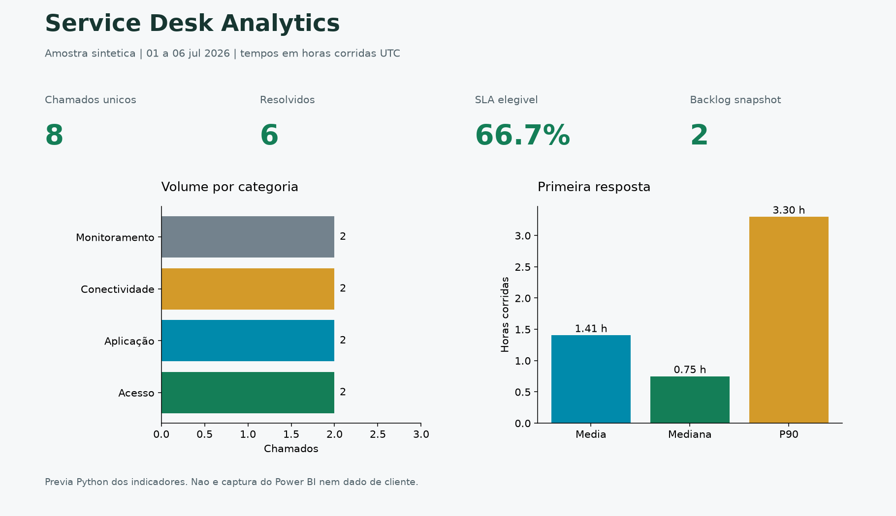

# Service Desk Analytics

[](https://github.com/CelsoKaiqueSil/service-desk-analytics/actions/workflows/ci.yml)

**Uma leitura clara do atendimento.** Indicadores de SLA, backlog, primeira
resposta e resolução, com metodologia explícita e detalhamento por chamado.

[Baixar Excel de exemplo](docs/examples/service_desk.xlsx) ·
[Modelo Power BI](powerbi/README.md) ·
[Executar](#executar) · [Regras de cálculo](#regras-auditaveis)

## Resultado em uma leitura



<sub>Prévia gerada em Python: 8 chamados, 6 resolvidos, backlog 2 e SLA de 4/6 (66,67%). O Excel contém visão executiva, chamados, segmentações, metodologia e qualidade.</sub>

> **Power BI:** o projeto PBIP inclui modelo estrela, DAX e duas páginas.
> A homologação nativa no Desktop está pendente. A imagem acima não é uma captura do Power BI.

## Regras auditaveis

Linhas identicas sao removidas. IDs com versoes conflitantes bloqueiam a geracao,
pois escolher silenciosamente uma linha poderia mudar o resultado. Datas invalidas
ou invertidas ficam na aba Qualidade. SLA sem prazo ou sem resolucao fica desconhecido.

O recorte e uma **coorte por data de abertura**, nao todo o backlog da operacao.
`--start` e `--end` aceitam datas inclusivas UTC; respostas e resolucoes posteriores
ao fim nao participam do resultado. Sem recorte, usa-se o snapshot da entrada.

[](https://github.com/CelsoKaiqueSil/service-desk-analytics/actions/workflows/ci.yml)
[](pyproject.toml)
[](src/service_desk_analytics/pipeline.py)
[](src/service_desk_analytics/pipeline.py)
[](src/service_desk_analytics/pipeline.py)
[](data/tickets.csv)

Projeto de Business Intelligence para consolidar o fluxo de atendimento de um
Service Desk em indicadores operacionais claros, auditáveis e reproduzíveis.

## Indicadores

- chamados abertos, resolvidos, encerrados e backlog;
- percentual de cumprimento de SLA;
- primeira resposta e solução em horas;
- média, mediana e percentil 90;
- volume por categoria, urgência e responsável;
- metodologia registrada junto ao relatório.

## Por que média, mediana e P90?

A média pode ser distorcida por poucos chamados muito longos. A mediana representa
o comportamento típico e o P90 mostra o limite abaixo do qual 90% dos atendimentos
foram concluídos. O uso conjunto evita conclusões simplistas.

## Arquitetura


## Executar

```bash
python -m venv .venv
source .venv/bin/activate  # Linux/macOS
python -m pip install -e ".[dev]"
service-desk-report --input data/tickets.csv --output output/service_desk.xlsx
pytest -q
```

No Windows PowerShell: `.\.venv\Scripts\Activate.ps1` em lugar de `source`.
Sem ativacao: use `.\.venv\Scripts\python.exe -m service_desk_analytics.pipeline`
e `.\.venv\Scripts\python.exe -m pytest`. Nao e preciso alterar politicas globais.

Exemplo historico: `service-desk-report --start 2026-07-01 --end 2026-07-01`.
Resultado esperado nessa coorte: 2 abertos, 1 resolvido e backlog 1.
O arquivo completo tem Dashboard com dois graficos, Tickets, Categorias,
Responsaveis, Metodologia e Qualidade. `python scripts/validate_exports.py`
verifica integridade. `python scripts/preview.py` regenera a imagem.

## Limites

Tempos sao corridos, nao horas uteis. A amostra nao comprova transferencia de filas,
reabertura ou contrato de cliente. Backlog historico de toda a operacao exige eventos
de status e tickets anteriores ao recorte. O Power BI tem fonte sintetica embutida
e nao publica nada em tenant. Nao ha benchmark profissional neste repositorio.

## Qualidade e privacidade

- tickets, pessoas, categorias e datas do exemplo são fictícios;
- identificadores permanecem como texto para preservar zeros e formatos;
- campos ausentes não são inferidos como cumprimento ou violação de SLA;
- as regras de cálculo ficam disponíveis na página `Metodologia`;
- nenhuma credencial ou resposta real de API é incluída.

## Contexto profissional

O estudo representa a consolidação de chamados e indicadores para reuniões de
acompanhamento, priorização de backlog e melhoria contínua do atendimento.
