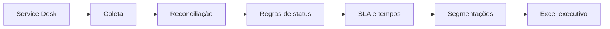

# Service Desk Analytics

[](https://github.com/CelsoKaiqueSil/service-desk-analytics/actions/workflows/ci.yml)
[](pyproject.toml)
[](src/service_desk_analytics/pipeline.py)
[](src/service_desk_analytics/pipeline.py)
[](src/service_desk_analytics/pipeline.py)
[](data/tickets.csv)

Projeto de Business Intelligence para consolidar o fluxo de atendimento de um
Service Desk em indicadores operacionais claros, auditáveis e reproduzíveis.

## Indicadores

- chamados abertos, resolvidos, encerrados e backlog;
- percentual de cumprimento de SLA;
- primeira resposta e solução em horas;
- média, mediana e percentil 90;
- volume por categoria, urgência e responsável;
- metodologia registrada junto ao relatório.

## Por que média, mediana e P90?

A média pode ser distorcida por poucos chamados muito longos. A mediana representa
o comportamento típico e o P90 mostra o limite abaixo do qual 90% dos atendimentos
foram concluídos. O uso conjunto evita conclusões simplistas.

## Arquitetura



## Executar

```bash
python -m venv .venv
python -m pip install -e ".[dev]"
service-desk-report --input data/tickets.csv --output output/service_desk.xlsx
pytest -q
```

## Qualidade e privacidade

- tickets, pessoas, categorias e datas do exemplo são fictícios;
- identificadores permanecem como texto para preservar zeros e formatos;
- campos ausentes não são inferidos como cumprimento ou violação de SLA;
- as regras de cálculo ficam disponíveis na página `Metodologia`;
- nenhuma credencial ou resposta real de API é incluída.

## Contexto profissional

O estudo representa a consolidação de chamados e indicadores para reuniões de
acompanhamento, priorização de backlog e melhoria contínua do atendimento.
