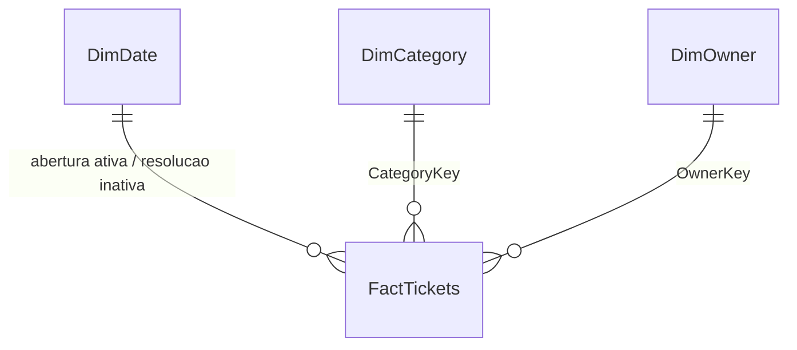

# Service Desk no Power BI

Projeto PBIP com modelo estrela, medidas DAX e duas paginas: Resumo e Detalhes.
Os oito chamados sao sinteticos; as fontes M estao embutidas no modelo para nao
exigir caminho local, credencial ou acesso corporativo.

## Abrir e conferir

1. No Power BI Desktop atualizado, habilite projetos PBIP/PBIR se a versao exigir.
2. Abra `ServiceDesk.pbip`, atualize os dados e confira o modelo.
3. Compare os totais sem filtros com `expected_metrics.json`: 8 chamados,
   6 resolvidos, 2 no backlog e SLA de 4/6 = 66,67%.
4. Filtre mes e analista. Confira que totais e detalhes mudam juntos.

O filtro de calendario representa **data de abertura**, nao backlog historico.
`Resolvidos por data` usa a relacao inativa de resolucao. O backlog desta demonstracao
e um snapshot, nao reconstitui transferencias de fila nem estados passados.
Ausencias de SLA ficam nulas; a mediana e o P90 nao substituem o SLA.

## Modelo

Geracao: `python scripts/build_powerbi.py`. CSVs, medidas e Power Query ficam
versionados. Nao ha refresh de API ou publicacao em tenant nesta demonstracao.
Para repetir a verificacao JSON, instale o extra `.[dev]` e execute
`python scripts/validate_powerbi.py`; o comando consulta schemas publicos da Microsoft
e requer acesso HTTPS. Isso nao executa as medidas DAX no Desktop.

## Estado de validacao

Arquivos JSON/PBIR validados contra schemas oficiais e relacionamentos verificados
por testes. O ambiente de desenvolvimento nao tem Power BI Desktop: abertura,
execucao DAX e renderizacao nativa ainda precisam de homologacao nesse aplicativo.
Nao apresentar a imagem de previa Python como captura do Power BI. O modelo e
executavel em formato de projeto, mas ainda nao e uma entrega nativamente homologada.

Referencias: [PBIP](https://learn.microsoft.com/power-bi/developer/projects/projects-overview)
e [PBIR](https://learn.microsoft.com/power-bi/developer/projects/projects-report).
